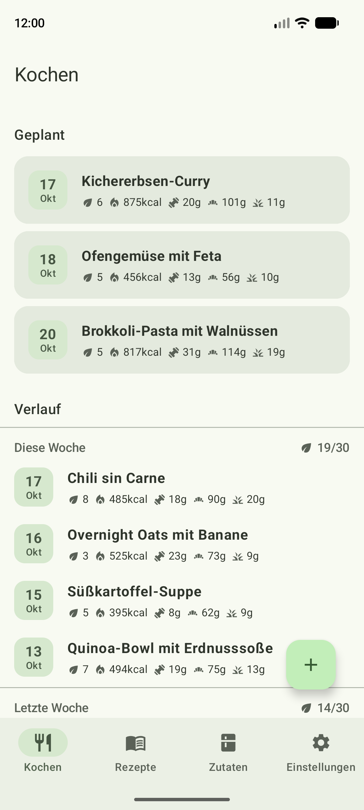
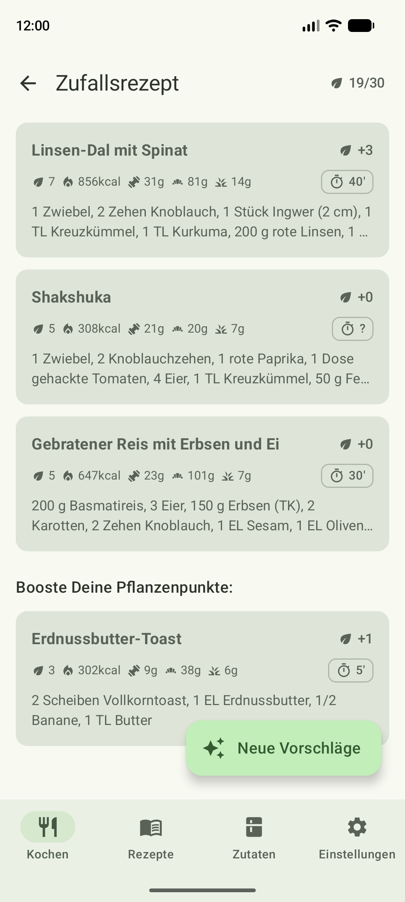
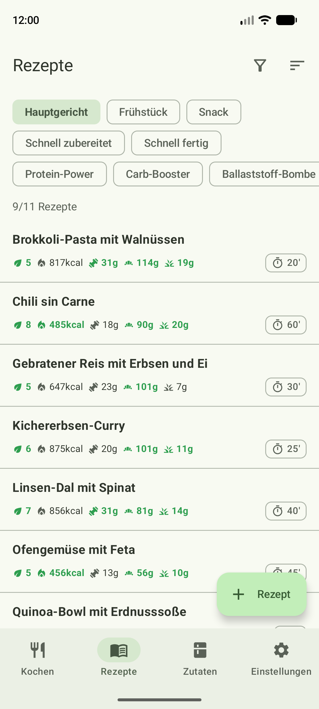
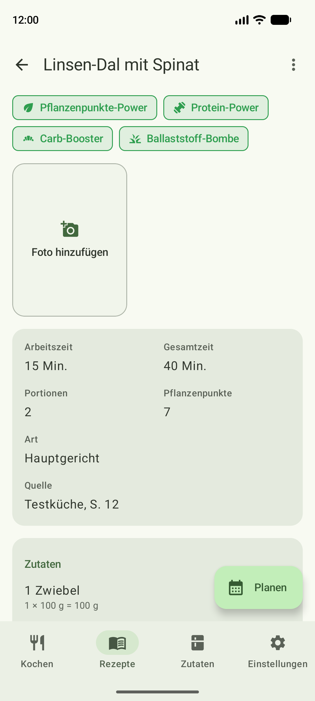
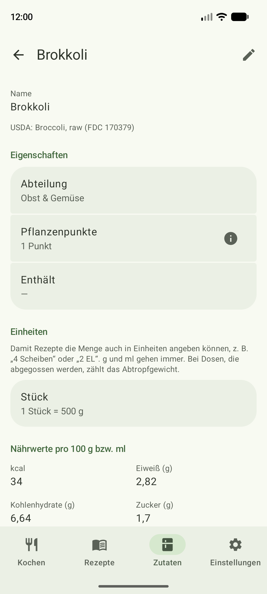

# Plantry

Android app (Jetpack Compose) for planning a weekly menu of home-cooked recipes.

<table>
  <tr>
    <td></td>
    <td></td>
    <td></td>
    <td></td>
    <td></td>
  </tr>
</table>

- **Plan** the week's cooking on Geplant; an evening reminder asks whether you cooked it
- **Suggestions** weighted by cooldown, protein and the plant points a recipe adds, plus a weekend boost
  from breakfasts and snacks
- **Plant points**: every distinct plant counts toward 30 a week
- **Scan recipes** from a cookbook photo with Claude (your own API key)
- **Ingredients** with nutrition from the bundled USDA SR Legacy data, a package barcode or product name search (Open Food Facts)
  or the label on the pack
- **Price per serving**: a rough estimate from the €/kg you enter per ingredient, naming what has no price yet
- **Cooking log** with search, and filters for what you want to cook with
- **Backup** of all recipes, ingredients and history to a file

<sub>The app is in German. Screenshots show the invented emulator test data (see below). Regenerate with
`./gradlew readmeScreenshots` (needs a running emulator; wipes the app's data on it).</sub>

## Nutrition data

Ingredient nutrition values and portion weights come from the
[USDA FoodData Central](https://fdc.nal.usda.gov/) **SR Legacy** dataset (April 2018 release),
bundled in the app as `app/src/main/assets/usda_sr_legacy.tsv` and searched offline; the app makes
no USDA API calls.

> U.S. Department of Agriculture, Agricultural Research Service. FoodData Central, 2019.
> fdc.nal.usda.gov.

USDA FoodData Central data is in the public domain
([CC0 1.0](https://creativecommons.org/publicdomain/zero/1.0/)).

To regenerate the asset, download the SR Legacy CSV release from
<https://fdc.nal.usda.gov/download-datasets>, unzip it and run:

```
python tools/usda_to_asset.py path/to/FoodData_Central_sr_legacy_food_csv_2018-04
```

## Emulator test data

Debug builds on an emulator start with invented test data from
`app/src/debug/assets/emulator-fixture.json` (a backup file: ingredients, recipes, aliases, cooking log, Geplant).
It is imported when the database is empty (fresh install, uninstall, wipe) and replaces all data whenever the
fixture changes. Dates are moved so the cooking log ends today. Phones and release builds are never touched.

When the backup format version is bumped, `EmulatorSeederTest` fails until the fixture uses the new fields
and the new `formatVersion`.
